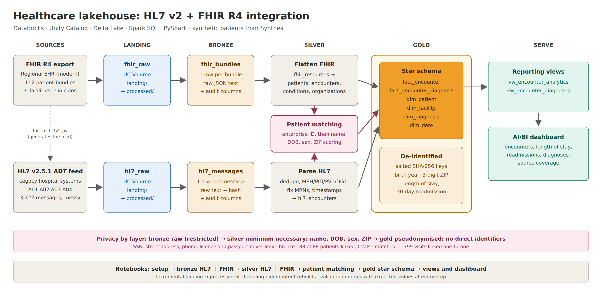

# Healthcare Lakehouse: HL7 v2 + FHIR R4 Integration

Most health systems are halfway through a migration. Newer systems expose patient data as **FHIR R4** resources, while older hospital systems still send **HL7 v2** messages: pipe-delimited admit, transfer and discharge events that have been the backbone of hospital integration for decades. Analysts need one view of the patient across both, but the two sources don't share an identifier, describe a hospital visit differently, and are rarely clean.

This project builds that one view. It loads a FHIR R4 export and a legacy HL7 v2 ADT feed into a Databricks lakehouse, parses and cleans both, links each legacy patient and visit to the matching FHIR record, and publishes a de-identified star schema with an analytics dashboard on top.

All data is synthetic. No real patient information is used anywhere.



## The data

**FHIR R4:** 112 synthetic patients from [Synthea](https://github.com/synthetichealth/synthea), the open-source patient simulator from MITRE: about 98,000 resources, including 5,087 encounters, 3,418 diagnoses and 267 facilities.

**HL7 v2.5.1 ADT feed:** I wrote `scripts/fhir_to_hl7v2.py` to turn the hospital encounters in those FHIR bundles into the feed a legacy system would have sent: 3,722 messages covering 1,799 visits for 88 patients, 2015 to 2026. It uses A01 admits, A02 transfers, A03 discharges and A04 registrations, with MSH, EVN, PID, PV1 and DG1 segments.

Because the feed is generated from the FHIR data, both sources describe the same people and visits, and I know the right answer for every link. The generator also writes a ground-truth file that the pipeline never reads, used only to measure matching accuracy afterwards.

To make the feed realistic, the generator breaks it in the ways real feeds break: re-sent duplicate messages, names in upper case, MRNs missing their leading zeros, three different timestamp formats, discharges without a discharge time, HL7 escape sequences in facility names, and an enterprise patient ID present on only about 60% of messages.

## How it works

**Bronze** stores everything exactly as received. HL7 lands as one row per message and FHIR as one row per bundle, both as raw text with audit columns (source file, file size, load time). Nothing is lost, so every later layer can be rebuilt from here. Files move from `landing/` to `processed/` once loaded, so each run only picks up new data.

**Silver** does the parsing and cleaning.
- *HL7:* duplicates are removed by message hash; each message is split into segments, fields and components (`PID-5.1` is the family name, `PV1-44` the admit time); MRNs, timestamps and escape sequences are repaired; and the admit, transfer and discharge messages for a stay are rolled up into one visit.
- *FHIR:* bundles are exploded into one row per resource, then Patient, Encounter, Condition and Organization are flattened into tables, with patient and facility keys pulled out of FHIR reference strings.

**Patient matching** links the two sources the way a master patient index would:
1. Pool identifiers across all of a patient's messages. 317 visits lacked the enterprise ID, but only 2 patients never had it on any message.
2. Link deterministically on the enterprise ID where it exists.
3. Otherwise, score every candidate on family name, given name, date of birth, sex and ZIP, giving partial credit for near-miss spellings. A link is accepted only if it scores at least 85 out of 100 *and* beats the runner-up by at least 10 points. Anything less goes to a review table instead of being guessed.
4. Link visits to encounters one-to-one on patient, facility, start time, encounter class and end time. A patient can have two encounters starting in the same minute at the same facility (an emergency visit that becomes an admission), so start time alone would link two visits to one encounter and double-count it.

**Gold** is a Kimball star schema: `fact_encounter` (one row per encounter, from both sources), a `fact_encounter_diagnosis` bridge, and dimensions for patient, facility, diagnosis (SNOMED CT) and date. It calculates length of stay and a 30-day inpatient readmission flag, and records whether each visit was also reported by the legacy feed.

## Privacy by layer

Identifiers are reduced at every step, keeping only what each layer needs:

| Layer | What it holds |
| --- | --- |
| Bronze | Raw data, including direct identifiers. Restricted. |
| Silver | Only what matching needs: name, date of birth, sex, ZIP. SSN, street address, phone, licence and passport are never extracted. |
| Gold | No direct identifiers. Patient and encounter IDs become salted SHA-256 keys; birth date becomes birth year; ZIP becomes its first three digits. |

Gold keeps encounter dates, because length of stay and readmission depend on them, so it is pseudonymised rather than fully anonymous. In production I would read the hashing salt from a secret scope and consider per-patient date shifting. The final check in the gold notebook confirms that no identifier columns reached gold.

## Results

| Check | Result |
| --- | --- |
| HL7 messages after removing duplicates | 3,613 of 3,722 (109 re-sends removed) |
| HL7 patients linked to FHIR | **88 of 88, 0 false matches** (86 by enterprise ID, 2 by demographics) |
| HL7 visits linked to FHIR encounters | **1,799 linked one-to-one; 1,795 confirmed correct** (the other 4 are two pairs of encounters identical in every recorded detail) |
| Demographic matching vs enterprise ID | agrees on 86 of 86 |
| Encounters in gold | 5,087 (1,799 reported by both sources) |
| Inpatient stays | 94, about 6 days on average, 2 readmitted within 30 days |

## Repository layout

```
notebooks/
  00_config                    shared catalog, volume paths and file-moving helper
  00_setup_volume_folders      creates landing/ and processed/ in both volumes
  01_bronze_hl7                HL7 feed → bronze.hl7_messages
  02_bronze_fhir               FHIR bundles → bronze.fhir_bundles
  03_silver_hl7                parse, clean and roll up HL7 into visits
  04_silver_fhir               explode and flatten FHIR resources
  05_silver_patient_match      record linkage, checked against the ground truth
  06_gold_star_schema          de-identified star schema
sql/
  01_setup_catalog_schemas_volumes.sql
  02_gold_views.sql            reporting views for the dashboard
scripts/fhir_to_hl7v2.py       generates the HL7 v2 feed from Synthea FHIR R4
data/hl7/                      the generated feed: 135 monthly files
data/validation/               ground truth for measuring matching accuracy
docs/                          architecture diagram and HL7 ↔ FHIR field map
```

## Running it

1. Run `sql/01_setup_catalog_schemas_volumes.sql`, then `notebooks/00_setup_volume_folders`.
2. Download the FHIR R4 sample from Synthea's sample data page and upload the JSON files to `/Volumes/health/bronze/fhir_raw/landing/`.
3. Upload the files in `data/hl7/` to `/Volumes/health/bronze/hl7_raw/landing/`.
4. Run notebooks `01` to `06` in order. Each one ends with validation queries showing the expected values.
5. Run `sql/02_gold_views.sql` and build the dashboard on `vw_encounter_analytics` and `vw_encounter_diagnoses`.

`docs/hl7_fhir_field_map.md` shows where each fact lives in both standards, from PID-3 to `Patient.identifier`.

## What I'd do next

- **Stream the HL7 feed.** Real ADT arrives message by message. Auto Loader or Structured Streaming would replace the monthly batch files.
- - **Map to OMOP.** Load the gold layer into the OMOP Common Data Model so it works with standard research tooling.
- **Govern access.** Apply Unity Catalog grants and column masks so bronze and silver are visible only to the integration team.
